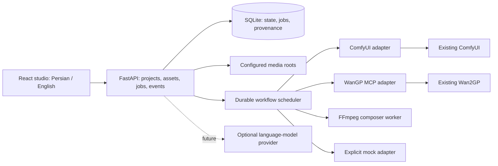

# Architecture and proposed decisions

Status: proposed implementation baseline for owner/implementer review. The owner authorized building this handoff; changes with a concrete rationale can be recorded in follow-up ADRs.

## ADR-001: Small modular application, external model engines

**Context:** One workstation, 8 GB GPU, existing isolated engines. Cloud development has no model access.

**Decision:** React/TypeScript/Vite frontend, FastAPI backend, SQLite state and one application scheduler. GPU execution stays in installed engines. Build frontend for serving from the backend on loopback in local release mode. Dev proxy is allowed. Mock adapters implement the same application contract with explicit mock provenance.

**Alternatives:** Next.js adds a second production app server with little benefit here. Microservices/Redis/Postgres and Docker add installation and recovery complexity. A browser-only frontend cannot safely own files, keys or durable GPU jobs.

**Consequences:** Two development toolchains, but one local release origin and no GPU dependencies in app. SQLite migration and worker ownership must be tested. Use one backend worker initially; durable scheduler ownership prevents accidental duplicate runners on a second process.

## ADR-002: Durable admission and recovery across engines

**Context:** Comfy and WanGP share the same physical GPU and can also receive external UI jobs. A cancelled HTTP request does not cancel inference. Comfy has no general server idempotency equivalent to WanGP request_id.

**Decision:** Persist workflow nodes, payload hashes, external IDs, request IDs and state transitions before/after dispatch. Acquire the global GPU slot transactionally; inspect both external queues before dispatch. Submit one job at a time, release the slot only when terminal external state is confirmed. Lost responses become unknown/reconciling. On restart reattach external jobs. WanGP retries keep the exact request_id and payload. For ambiguous Comfy submissions, reconcile via history/queue and correlation metadata; if proof is unavailable, require user resolution instead of resubmission.

**Alternatives:** In-memory queue loses state; submitting a batch to each engine defeats cross-engine sequencing; blind retries duplicate expensive jobs.

**Consequences:** Unknown jobs can intentionally block the queue with an explanation. The app cannot forcibly prevent a user starting jobs directly in an engine after its health check; detect conflicts, pause further admission and show this limitation. Do not promise an exclusive GPU lock over unrelated applications.

## ADR-003: Reference assets, explicit storage and CPU assembly

**Decision:** Store metadata and references in SQLite; keep original engine files in their existing roots. Stream authorized media, cache thumbnails under configured data root. Copy only when explicit project import/export needs it. Use FFmpeg via an argument array (no shell) for assembly, CPU encoding fallback, generated safe filter graphs, staged output and atomic final rename on the same volume. Project deletion/archive never silently deletes original media.

**Trade-offs:** References can become stale; report missing files. CPU encoding is slower but avoids GPU contention. Inputs with unlike dimensions/fps/audio layouts require deliberate normalization before concat/mixing. Preflight disk estimate is approximate; recheck during work and clean only app-owned failed staging files.

## Data and API design requirements

Implement typed Project, Asset, Recipe/RecipeVersion, Workflow, Node, Job, EngineJob, Export and Settings models. Each asset records origin (import/comfy/wan/mock/composition), path or safe external reference, media type, dimensions, duration/fps/sample rate where applicable, settings snapshot, parents and engine job ID. Preserve versions for reproducibility.

Expose typed app endpoints for projects/assets/jobs/workflows/compositions/settings/health and an SSE or WebSocket event stream. Use stable asset/job IDs externally, structured errors and persisted events/revisions. Paginate gallery/history. Clients reconnect from an event cursor or refetch canonical state without replaying commands. Long jobs never hold a request open until inference completes.

## Failure modes

Engine crash, MCP session expiry, process restart, lost submit reply, unknown cancellation, missing asset, unsupported node, disk reserve breach, FFmpeg failure and invalid subtitles must have tested transitions. Redact sensitive values from logs. No error path may silently switch a real job to mock output.
